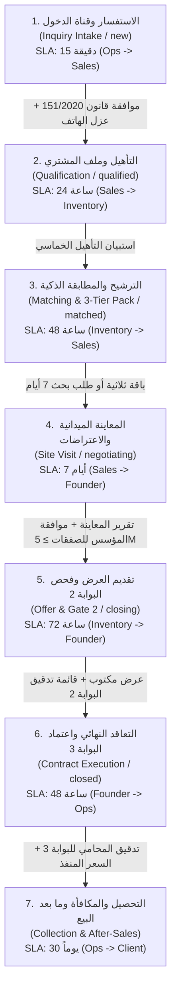

# 1Line OS - End-to-End Reference Customer Journey (دليل رحلة العميل المرجعية)

## نظرة عامة
تحدد هذه الوثيقة الرحلة المرجعية الرسمية للعميل المشتري (Buyer Customer Journey) في نظام **1Line OS** لقطاع العقارات بسوهاج والقاهرة، استناداً إلى كتاب قواعد الشركة (Company Playbook) المعتمد من د. محمود الباز.

تضمن هذه الرحلة انتقال كل عميل بين الأقسام التشغيلية عبر **7 مراحل تسلسلية** محكومة ببوابات مخرجات إلزامية (Stage Gate Deliverables)، ومهام تفويض بين الأقسام (Inter-Departmental Handoff Tasks) مع مهل زمنية (SLA) محددة بالساعة، ونموذج مالي حازم لحساب العمولات والحوافز.

---

## المراحل السبع وبوابات المخرجات (The 7 Sequential Stages & Deliverable Gates)



---

### المرحلة 1: الاستفسار وقناة الدخول (Inquiry Intake)
- **المرحلة في النظام:** `new`
- **القسم المسؤول:** إدارة العمليات (`ops`)
- **المهلة الزمنية (SLA):** 15 دقيقة (خلال ساعات العمل).
- **المخرج الإلزامي (Mandatory Deliverable):**
  - تسجيل العميل كـ `Person` مع إثبات الموافقة الصريحة للتواصل التسويقي وفقاً لقانون حماية البيانات الشخصية المصري **151/2020** (`consent: true`, `consentDate`).
  - عزل أرقام الهواتف والواتساب في سجل منفصل تماماً `person_contacts` وعدم تسريبها في السجل العام، واشتراط صلاحية `ld.phone` للاطلاع عليها.
- **المهمة المولدة بين الأقسام:**
  - **Task 1:** `عميل مشترٍ مسجّل بمصدره` (من `ops` إلى `sales` — SLA: 0.25 ساعة / 15 دقيقة).

---

### المرحلة 2: التأهيل وملف المشتري (Qualification)
- **المرحلة في النظام:** `qualified`
- **القسم المسؤول:** قطاع المبيعات (`sales`)
- **المهلة الزمنية (SLA):** 24 ساعة.
- **المخرج الإلزامي:**
  - استكمال أسئلة التأهيل الخمسة الأساسية لملف المشتري (`buyerProfile`):
    1. الميزانية المحددة (الحد الأدنى والأقصى).
    2. طريقة السداد (كاش / أقساط / تمويل عقاري).
    3. المناطق أو القطاعات المستهدفة (حي شرق، سوهاج الجديدة، سيتي، إلخ).
    4. الغرض من الشراء (سكن / استثمار / عيادة / تجاري).
    5. مهلة اتخاذ القرار (فوري / شهر / 3 أشهر).
- **المهمة المولدة بين الأقسام:**
  - **Task 3:** `طلب بحث موجّه` (من `sales` إلى `inventory` — SLA: 48 ساعة).

---

### المرحلة 3: الترشيح والمطابقة الذكية (Matching & 3-Tier Nomination)
- **المرحلة في النظام:** `matched`
- **القسم المسؤول:** إدارة المخزون والمبيعات (`inventory` / `sales`)
- **المهلة الزمنية (SLA):** 48 ساعة.
- **المخرج الإلزامي:**
  - تشغيل محرك المطابقة `matchingEngineV2` مع تصفية العقارات المستبعدة (اعتراضات سابقة، مطورون مستبعدون، عدم اجتياز البوابة 1).
  - **في حالة توفر $\ge 3$ عقارات:** اعتماد باقة الترشيحات الثلاثية (قاعدة 1Line الذهبية):
    1. **الخيار الأقرب (Closest):** يطابق المنطقة والميزانية والمواصفات بدقة.
    2. **خيار القيمة (Value):** أكبر مساحة وأفضل سعر للمتر المربع.
    3. **خيار التحدي (Challenge):** أعلى في الميزانية بما لا يتجاوز 10% أو خيار استثماري بميزة استثنائية.
    - توليد رسالة واتساب الرسمية ببيانات الوحدات.
  - **في حالة توفر $< 3$ عقارات:** الفتح التلقائي لطلب بحث موجّه (`SearchRequest`) بمهلة حازمة مدتها **7 أيام** لفريق المخزون.
- **المهمة المولدة بين الأقسام:**
  - **Task 4:** `عقارات A مطابقة + مذكراتها` (من `inventory` إلى `sales` — SLA: 168 ساعة / 7 أيام).

---

### المرحلة 4: المعاينة الميدانية والاعتراضات (Site Visit & Inspection)
- **المرحلة في النظام:** `site_visit` ثم `negotiating`
- **القسم المسؤول:** قطاع المبيعات (`sales`)
- **المهلة الزمنية (SLA):** 7 أيام (168 ساعة).
- **المخرج الإلزامي:**
  - تسجيل تقرير المعاينة الميدانية المكتوب (`siteVisitReport`) مع توثيق ملاحظات العميل واعتراضاته.
  - **اشتراط صفقات القيمة العالية (High-Value Threshold $\ge 5\text{M}$ EGP):** إذا كانت قيمة الوحدة أو ميزانية العميل $\ge 5,000,000$ ج.م، يُشترط حصراً تصعيد العرض لمؤسس الشركة (د. محمود الباز) والحصول على موافقته (`isFounderApproved: true`) قبل الانتقال للتفاوض، ويُمنع مستشار المبيعات من تجاوز هذه البوابة بمفرده.
- **المهمة المولدة بين الأقسام:**
  - **Task 7:** `عرض فوق الحد أو خارج الهامش` (من `sales` إلى `founder` — SLA: 2 ساعة).

---

### المرحلة 5: تقديم العرض المالي وفحص البوابة 2 (Offer & Gate 2)
- **المرحلة في النظام:** `closing`
- **القسم المسؤول:** المبيعات والمؤسس (`sales` / `founder`)
- **المهلة الزمنية (SLA):** 72 ساعة.
- **المخرج الإلزامي:**
  - تقديم عرض شراء مكتوب (`writtenOffer`) يحدد السعر المعروض، الدفعة المقدمة، وأقساط السداد.
  - اجتياز قائمة تدقيق البوابة 2 الفنية (`Gate 2 Checklist`):
    - إعادة تأكيد السعر والتوفر من المالك.
    - استخراج الشهادة العقارية السلبية (Negative Certificate).
    - تجهيز مذكرة العقار (Property Memorandum).
    - إبلاغ العميل كتابياً بنوع السند الملكية.
- **المهمة المولدة بين الأقسام:**
  - **Task 8:** `المستندات الأصلية (البوابة 3)` (من `inventory` إلى `founder` — SLA: 48 ساعة).

---

### المرحلة 6: التعاقد النهائي واعتماد البوابة 3 (Contract & Gate 3)
- **المرحلة في النظام:** `closed`
- **القسم المسؤول:** المؤسس والمستشار القانوني (`founder` / Legal Desk)
- **المهلة الزمنية (SLA):** 48 ساعة.
- **المخرج الإلزامي:**
  - اجتياز قائمة تدقيق البوابة 3 القانونية النهائية (`Gate 3 Checklist`):
    - فحص أصول المستندات بواسطة محامي الشركة.
    - صياغة العقد بواسطة محامي الشركة.
    - التحقق من وسيلة الدفع الموثقة.
    - توقيع اتفاقية عمولة الوساطة العقارية الرسمية.
    - تسجيل السعر المنفذ النهائي (`executedPrice > 0`).
- **المهمة المولدة بين الأقسام:**
  - **Task 9:** `صفقة مغلقة وبيانات العمولة` (من `founder` إلى `ops` — SLA: 12 ساعة).

---

### المرحلة 7: التحصيل والعمولات وما بعد البيع (Collection & After-Sales)
- **المرحلة في النظام:** `after_sales` / `delivered`
- **القسم المسؤول:** إدارة العمليات ورعاية العملاء (`ops` / Client Care)
- **المهلة الزمنية (SLA):** 720 ساعة (30 يوماً).
- **المخرج الإلزامي والنموذج المالي:**
  1. **فاتورة العمولة (`commission_invoices`):**
     - احتساب عمولة المشتري بنسبة 2.5% (أو النسبة التعاقدية المحددة).
  2. **إيصال التحصيل الفعلي (`collections`):**
     - تسجيل المبلغ المحصل، رقم الإيصال، وتاريخ التحصيل الفعلي.
  3. **قاعدة حافز مسؤول المبيعات الصارمة (Strict Sales Incentive Rule):**
     $$\text{مكافأة مسؤول المبيعات} = \left(\frac{\text{المبلغ المحصّل فعلياً}}{1,000,000}\right) \times 5,000\text{ ج.م}$$
     - **قاعدة ذهبية:** المكافأة تُستحق حصراً وفوراً **بعد التحصيل الفعلي** للمبلغ! قيمة المكافأة تكون $0$ ج.م قبل التحصيل، ولا تصرف أبداً لمجرد توقيع العقد أو إصدار الفاتورة.
  4. **مهمة ما بعد البيع والإحالة:**
     - **Task 10:** `متابعة ما بعد البيع وطلب الإحالة` (من `ops` إلى `client` — SLA: 720 ساعة / 30 يوماً للتأكد من رضا العميل، تليها متابعة طلب الإحالة بعد 90 يوماً).

---

## جدول مهام التفويض بين الأقسام (Departmental Handoffs Table 1-10)

| رقم المهمة | من قسم | إلى قسم | مسمى المخرج / المهمة | المهلة (SLA) |
|---|---|---|---|---|
| **Task 1** | العمليات (`ops`) | المبيعات (`sales`) | عميل مشترٍ مسجّل بمصدره وموافقته | 15 دقيقة (0.25 س) |
| **Task 2** | العمليات (`ops`) | المخزون (`inventory`) | عميل مالك عقار مسجّل | 15 دقيقة (0.25 س) |
| **Task 3** | المبيعات (`sales`) | المخزون (`inventory`) | طلب بحث موجّه (5 أسئلة تأهيل) | 48 ساعة |
| **Task 4** | المخزون (`inventory`) | المبيعات (`sales`) | عقارات A مطابقة + مذكراتها (باقة 3) | 168 ساعة (7 أيام) |
| **Task 5** | المبيعات (`sales`) | المؤسس (`founder`) | عميل مؤهل للقاهرة + ملفه | 168 ساعة (7 أيام) |
| **Task 6** | المؤسس (`founder`) | المطور (`developer`) | تسجيل العميل باسم 1Line | 24 ساعة |
| **Task 7** | المبيعات (`sales`) | المؤسس (`founder`) | عرض فوق الحد أو صفقة كبرى ($\ge 5$M) | ساعتان (2 س) |
| **Task 8** | المخزون (`inventory`) | المؤسس (`founder`) | المستندات الأصلية (البوابة 3) | 48 ساعة |
| **Task 9** | المؤسس (`founder`) | العمليات (`ops`) | صفقة مغلقة وبيانات العمولة | 12 ساعة |
| **Task 10** | العمليات (`ops`) | العميل (`client`) | متابعة ما بعد البيع وطلب الإحالة | 720 ساعة (30 يوماً) |

---

## أدوات البرمجة والمحاكاة المتاحة في الكود

### 1. استدعاء المحاكاة الكاملة (E2E Simulation Runner)
```javascript
import { runReferenceCustomerJourneySimulation } from './src/services/referenceCustomerJourney.js';

const result = runReferenceCustomerJourneySimulation({
  clientName: 'م. حسام الدين',
  source: 'founder_content',
  budgetMin: 3000000,
  budgetMax: 3500000,
  offeredPrice: 3200000,
  executedPrice: 3200000,
  collectedAmount: 80000 // 2.5% of 3.2M
});

console.log(result.summary);
// {
//   clientName: 'م. حسام الدين',
//   finalStage: 'closed',
//   executedPrice: 3200000,
//   totalCommission: 80000,
//   collectedAmount: 80000,
//   agentIncentive: 400, // (80,000 / 1,000,000) * 5,000 EGP
//   tasksGeneratedCount: 7
// }
```

### 2. تدقيق التزام العميل بالمراحل (Journey Compliance Auditor)
```javascript
import { auditLeadJourney } from './src/services/referenceCustomerJourney.js';

const audit = auditLeadJourney(lead);
console.log(audit.progressPercent); // e.g. 100%
console.log(audit.gatesStatus);
```
